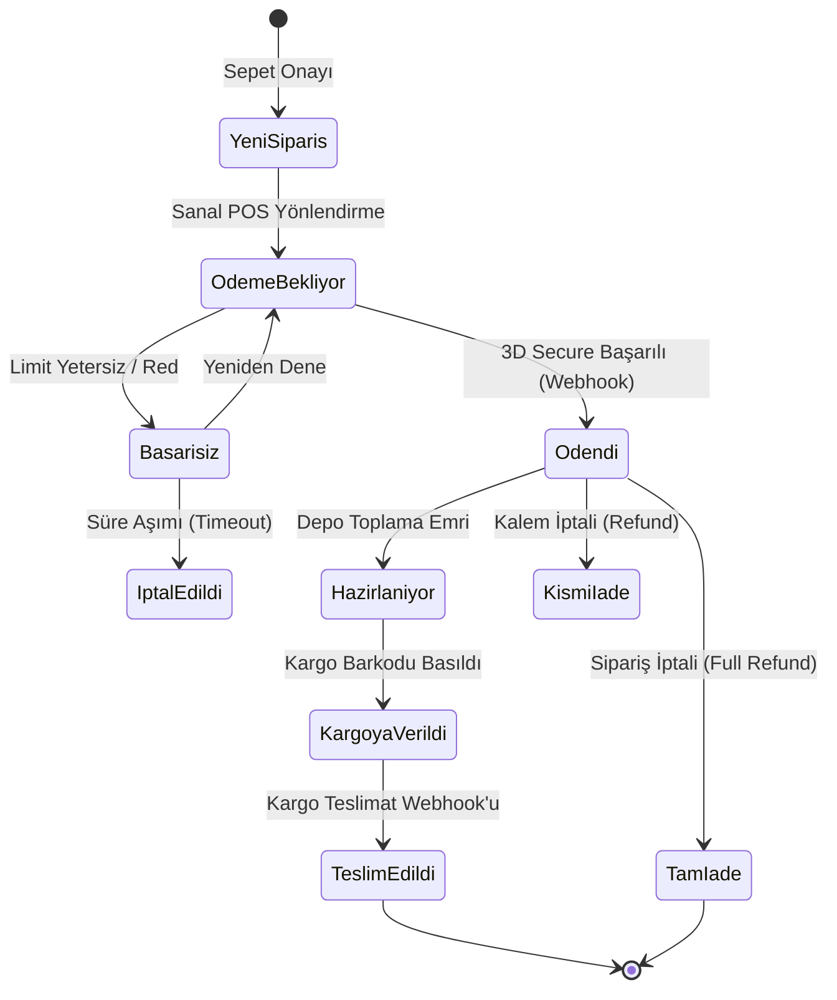

# E-Ticaret Kasa, Ödeme ve Sipariş Operasyon Sözleşmesi

> **Durum:** Tasarım ve Sözleşme Şartnamesi  
> **Hedef:** E-ticaret sipariş akışı, sanal POS ödeme ve kasa mutabakat süreçlerinin mimari şartnamesi.  
> **Son Güncelleme:** 5 Kasım 2026  
> **İlgili Ana Belge:** [docs/README.md](../README.md)  

---

## 🏛️ 1. İş Değeri ve Operasyonel Kapsam

Bu modül, müşterinin vitrinden yaptığı satın alma işleminin paraya dönüşmesini (tahsilat), siparişin hazırlanıp kargolanmasını (sevkiyat) ve gün sonu ciro/kasa mutabakatını yöneten finans ve lojistik merkezidir.

### Temel Sorumluluklar:
1. **Sanal POS Entegrasyonu (Payments):** Kredi kartı, 3D Secure, taksitli çekim ve webhook geri bildirimleri.
2. **Sipariş Durum Makinesi (Order State Machine):** `PendingPayment -> Paid -> Processing -> Shipped -> Completed (veya Cancelled / Refunded)`.
3. **Parçalı ve Tam İade (Refund):** İptal edilen ürünlerin kart hesabına otomatik geri iade edilmesi.
4. **Günlük Hasılat & Kasa Raporu:** Brüt satış, komisyon giderleri, net hakediş ve mutabakat dökümü.

---

## 📑 2. Hedef Veritabanı Şemaları

İzolasyon kuralı gereği bu iş alanı iki şemaya ayrılır:

### A. `payments` Şeması (Tahsilat & Kasa)
* `payments.Transactions`: Transaction ID, Sipariş ID, Sağlayıcı (`Iyzico`, `PayTR`, `Stripe`), Tutar, Para Birimi, Durum (`Success`, `Failed`, `Pending`), Hata Kodu.
* `payments.Refunds`: İade ID, Transaction ID, İade Tutarı, Gerekçe, Yapan Yönetici ID'si, Zaman Damgası.
* `payments.DailySettlements`: Gün sonu blokaj ve hakediş mutabakat kayıtları.

### B. `orders` Şeması (Sipariş & Sevkiyat)
* `orders.Orders`: Sipariş No, Müşteri ID, Toplam Tutar, KDV Tutarı, Sipariş Durumu, Kargo Takip Kodu.
* `orders.OrderItems`: Sipariş ID, Ürün ID, Varyant ID, Adet, Birim Fiyat.
* `orders.Shipments`: Sipariş ID, Kargo Firması (`Yurtici`, `Aras`, `MNG`), Takip Numarası, Barkod URL, Çıkış Tarihi.

---

## 🔄 3. Sipariş ve Ödeme Yaşam Döngüsü (State Flow)

---

## 🖥️ 4. Hedef Admin Ekran Davranışları

1. **Sipariş Yönetimi Ekranı (`OrdersPage.tsx`):**
   - Sipariş durum sekmeleri: `[ Tümü ]`, `[ Yeni (3) ]`, `[ Hazırlanıyor (12) ]`, `[ Kargoda (45) ]`, `[ İade/İptal (2) ]`.
   - Sipariş detay çekmecesi (Drawer): Müşteri adresi, sipariş verilen ürünler, uygulanan kupon ve kargo barkodu dökümü.
2. **Kasa & Tahsilat Monitörü (`CashierPage.tsx`):**
   - Anlık başarılı/başarısız tahsilat akışı.
   - Başarısız ödemelerin hata sebepleri (Kart limiti, banka güvenlik bloğu vb.).
   - Tek tıkla "Kart İadesi Yap" yetki onaylı modalı.

---

## 🛡️ 5. Güvenlik ve İdempotency Kriterleri

* **Çift Çekim Engelleme (Idempotency Key):** Sanal POS istekleri sipariş bazlı benzersiz bir `Idempotency-Key` başlığı taşımalıdır; ağ gecikmesinde müşteriden asla mükerrer para çekilemez.
* **Webhook İmzası Doğrulama:** Sağlayıcıdan gelen webhook çağrılarının HMAC-SHA256 imzası doğrulanmadan sipariş durumu `Paid` yapılamaz.
