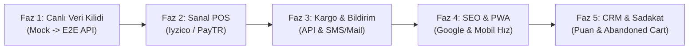

# [Modül Şartnamesi] Müşteri Deneyimi, E-Ticaret Mağazası ve Storefront Modülü (Customer & Storefront)

> **Modül Kodu:** `MOD-04-CUST`  
> **Durum:** ✅ MVP Tamamlandı (Uçtan Uca Backend Şemaları + React 19 Storefront Arayüzü)  
> **Son Güncelleme:** 11 Kasım 2026  
> **Sorumlu Katmanlar:**  
> - **Backend:** `backend/src/Domain/Entities/{Catalog, Cart, Customer, Orders, Payments, Promotions, Content, Experience}/`, `Application/`, `Infrastructure/`, `Endpoints/`  
> - **Frontend:** `frontend/src/pages/storefront/`, `frontend/src/pages/products/`, `frontend/src/pages/cart/`, `frontend/src/pages/checkout/`, `frontend/src/pages/account/`, `frontend/src/pages/auth/`, `frontend/src/api/storefront/`  
> **Veritabanı Şemaları:** `catalog`, `cart`, `customer`, `orders`, `promotions`, `content`, `experience` (PostgreSQL 18)  
> **İlgili Ana Belgeler:** [docs/README.md](../README.md) · [YAPILANLAR_VE_TAMAMLANANLAR.md](../00-devir-rehberi/YAPILANLAR_VE_TAMAMLANANLAR.md) · [YAPILACAKLAR_VE_FAZ_HARITASI.md](../00-devir-rehberi/YAPILACAKLAR_VE_FAZ_HARITASI.md)

---

## 🎯 1. Modülün Amacı ve Vizyonu

**Müşteri Deneyimi ve E-Ticaret Mağazası (Storefront) Modülü**; doğrudan son tüketiciye (B2C) yönelik, Anadolu'nun geleneksel, katkısız ve kooperatif üretim doğal gıdalarını modern bir e-ticaret deneyimiyle buluşturan müşteri vitrinidir.

Sistemde **Modüler Monolit** mimarisi ve **Single Source of Truth (Tek Gerçek Kaynak)** ilkesi benimsenmiştir:
1. **Tek Kaynak İlkesi:** Admin panelinden eklenen ya da güncellenen ürünler, stok miktarları, partiler (lot), alerjenler ve saklama koşulları harici bir entegrasyona gerek kalmadan doğrudan müşteri vitrininde (`/api/catalog/*`) anında yansır.
2. **Kusursuz Görsel Kimlik:** Eski arayüz kopyalarından ve ekran görüntüsü artıklarından arındırılmış; stüdyo ve otantik köy sofrası kalitesinde yüksek çözünürlüklü doğal gıda fotoğrafları kullanılır.
3. **Misafirden Sadık Müşteriye:** Kullanıcı üye olmadan sepet oluşturabilir (`X-Guest-Cart-Token`); üye girişi yaptığı anda misafir sepeti müşteri hesabıyla otomatik birleştirilir (`merge`).

---

## 🏛️ 2. Şu Ana Kadar Yapılanlar ve Tamamlananlar (Geliştirme Günlüğü)

Projedeki `8f5511e` (Müşteri backend oluşturuldu), `7517f8e` (Admin ve Müşteri birleşimi), `d1fc598` (Katalog tek kaynak bağlantısı), `5a6f0fc` (Müşteri frontend tamamlandı) ve son görsel iyileştirme commit'leri temel alınarak tamamlanan tüm kabiliyetler aşağıdadır:

### 🧩 A. Müşteri Backend Altyapısı (.NET 10 Clean/Onion Architecture)

Backend tarafında her biri PostgreSQL üzerinde kendi şemasına sahip, tam yalıtımlı 8 müşteri odaklı alt modül kurulmuştur:

```
backend/src/
├── Domain/Entities/
│   ├── Catalog/       -> Product, Category, ProductImage, ProductVariant, ProductAttribute
│   ├── Cart/          -> ShoppingCart, CartItem
│   ├── Customer/      -> Customer, CustomerAddress, RefreshToken, Wishlist
│   ├── Orders/        -> Order, OrderLine, Shipment
│   ├── Payments/      -> SimulatedPayment
│   ├── Promotions/    -> Coupon
│   ├── Content/       -> Banner, BrandStory, CampaignAnnouncement, Faq, FeaturedCategory, ShowcaseSection
│   └── Experience/    -> ProductReview, ContactMessage, NewsletterSubscription, Policy
├── Application/       -> DTO'lar, FluentValidation kuralları, servis arayüzleri, CouponCalculator
├── Infrastructure/    -> EF Core DbContext'leri, PostgreSQL şema konfigürasyonları, ReservationExpiryWorker
└── Endpoints/         -> Minimal API modül uzantıları ve Handler sınıfları
```

#### 1. Veritabanı Şemaları ve EF Core Modelleri
* **`catalog` Şeması:** Ürünler, hiyerarşik kategoriler, ürün varyantları (gramaj, ambalaj), dinamik nitelikler ve çoklu görsel galerisi.
* **`cart` Şeması:** Müşteri ID veya Misafir UUID ile izole sepetler; sepete eklenen ürünlerin anlık stok rezervasyonu.
* **`customer` Şeması:** PBKDF2 SHA-256 ile şifrelenmiş müşteri hesapları, teslimat/fatura adresleri, JWT refresh token'ları ve favori (wishlist) listeleri.
* **`orders` Şeması:** Sipariş başlıkları, sipariş satırları, kargo/sevkiyat (`Shipment`) ve simüle edilmiş ödeme kayıtları.
* **`promotions` Şeması:** İndirim kuponları, minimum sepet tutarı kısıtları, yüzde veya sabit indirim hesaplayıcıları (`CouponCalculator`).
* **`content` Şeması:** Ana sayfa banner'ları, 'Bizim Hikâyemiz' üretici kartları, Sıkça Sorulan Sorular (SSS) ve öne çıkan vitrin bölümleri.
* **`experience` Şeması:** Ürün yorum ve değerlendirmeleri (1–5 yıldız), iletişim formu mesajları, e-bülten abonelikleri.

#### 2. Canlı Minimal API Uç Noktaları
* **Katalog API (`/api/catalog/*`):**
  - `GET /api/catalog/products`: Filtrelenebilir (kategori, fiyat, arama, etiket), sayfalanabilir ürün listesi.
  - `GET /api/catalog/products/{slug}`: SEO uyumlu slug ile ürün detay ve varyantları.
  - `GET /api/catalog/categories` & `/categories/tree`: Hiyerarşik kategori ağacı.
* **Sepet API (`/api/cart/*`):**
  - `POST /api/cart/guest`: Anonim misafir sepeti token'ı oluşturma.
  - `GET /api/cart`: Güncel sepet görünümü, toplamlar, kargo bedeli ve indirimler.
  - `PUT /api/cart/items` & `DELETE /api/cart/items/{id}`: Sepete ürün ekleme, miktar güncelleme (+1/-1), çıkarma.
  - `PUT /api/cart/coupon` & `DELETE /api/cart/coupon`: Kupon kodu doğrulama ve sepetten kaldırma.
  - `POST /api/cart/merge`: Giriş yapıldığında misafir sepetini müşteri hesabına aktarma.
* **Kimlik Doğrulama & Müşteri API (`/api/auth/*` ve `/api/customer/*`):**
  - `POST /api/auth/register`, `POST /api/auth/login`, `POST /api/auth/refresh`, `POST /api/auth/logout`.
  - `GET/PUT /api/customer/me`: Profil bilgileri okuma ve güncelleme.
  - `GET/POST/DELETE /api/customer/addresses`: Teslimat ve fatura adresleri yönetimi.
  - `GET/POST/DELETE /api/customer/wishlist`: Favori ürünler listesi.
* **Sipariş & Ödeme API (`/api/orders/*` ve `/api/payments/*`):**
  - `POST /api/orders`: Sepeti siparişe dönüştürme ve stok düşümü.
  - `GET /api/orders/my-orders` ve `/api/orders/{id}`: Müşteri sipariş geçmişi ve detay takibi.
  - `POST /api/payments/pay`: Kasa ödeme simülasyonu.
* **Deneyim & İçerik API (`/api/experience/*` ve `/api/content/*`):**
  - `POST /api/experience/reviews`: Ürün değerlendirmesi ve yıldız verme.
  - `POST /api/experience/newsletter`: E-bülten kaydı.
  - `GET /api/content/banners`, `/stories`, `/faqs`: Dinamik vitrin içerikleri.

#### 3. Arka Plan İşçisi (Worker Service)
* **`ReservationExpiryWorker`:** Sepette bekletilen ürünlerin sonsuza kadar stoğu kilitlememesi için, yapılandırılan süre (varsayılan: 30 dk) sonunda süresi dolan sepet rezervasyonlarını otomatik olarak serbest bırakır.

---

### 🎨 B. Müşteri Frontend Arayüzü (React 19 + TypeScript + Tailwind)

Müşteri arayüzü; sıcak toprak tonları, zeytin yeşili ve köy dokusu paletiyle (`bg-surface`, `primary: #132f1d`, `secondary: #7d553d`, `surface-container: #f6eddb`) tasarlanmıştır:

#### 1. Tamamlanan Müşteri Ekranları
* **1. Ana Sayfa Vitrini ([`StorefrontPage.tsx`](../../frontend/src/pages/storefront/StorefrontPage.tsx)):**
  - Zengin Anadolu Köy Sofrası bento vitrin alanı (`hero-bento-showcase.png`).
  - Dörtlü güven bandı (Kırılmaz Ambalaj, Buz Akülü Soğuk Koruma, %100 Katkısız Geleneksel Şirden Maya, 750 TL Üzeri Ücretsiz Kargo).
  - 6 Temel kategori kartı (Köy Kahvaltılıkları, Taş Baskı Zeytinyağı, Güneşte Kurutulmuş Salçalar, Ev Yapımı Reçel & Bal, Yöresel Erişte & Bakliyat, Kuruyemiş & Kuru Meyve).
  - Çok satanlar vitrini ve sekmeli filtreleme (Tümü, Kahvaltılık, Zeytinyağı, Salça).
  - "Mehmet Ali Dayı & Hacıpaşa Köyü" hikâye ve üretici kooperatifi spotu.
  - Mevsim lezzetleri ve dinamik müşteri yorumları vitrini.
* **2. Tüm Ürünler & Filtreleme ([`ProductsPage.tsx`](../../frontend/src/pages/products/ProductsPage.tsx)):**
  - Kategori, coğrafi yöre (Ege, Hatay, Antep, Kars, Karadeniz), fiyat aralığı ve etiket filtreleri.
  - Anlık metin araması, sıralama (Fiyat artan/azalan, En çok satan, Puan) ve sayfalama.
  - Mobil uyumlu filtre çekmecesi ve görünüm değiştirici (Grid / Liste).
* **3. Ürün Detay Sayfası ([`ProductDetailPage.tsx`](../../frontend/src/pages/products/ProductDetailPage.tsx)):**
  - Çoklu açı fotoğraf galerisi (küçük resim seçici, tam ekran büyütme).
  - Varyant ve ambalaj seçici (500g, 1000g, Teneke / Cam).
  - Alerjen ikonları, saklama koşulu uyarıları ve 100g yasal besin tablosu.
  - Doğrulanmış alıcı yorumları, puan dağılım çubukları ve benzer ürün önerileri.
* **4. Sepet Sayfası ([`CartPage.tsx`](../../frontend/src/pages/cart/CartPage.tsx)):**
  - Dinamik kargo barı (*"750 TL üzerine ücretsiz kargo, X TL kaldı"* animasyonlu ilerleme çubuğu).
  - Miktar artırma/azaltma, silme, kupon kodu giriş alanı ve sepet özeti.
* **5. Ödeme / Kasa Ekranı ([`CheckoutPage.tsx`](../../frontend/src/pages/checkout/CheckoutPage.tsx)):**
  - Teslimat adresi seçimi, fatura bilgileri, soğuk zincir teslimat notu.
  - Kredi kartı simülasyonu ve sipariş tamamlama adımları.
* **6. Bizim Hikâyemiz ([`OurStoryPage.tsx`](../../frontend/src/pages/storefront/OurStoryPage.tsx)):**
  - Yerel üretici hikayeleri, kooperatif dayanışması ve geleneksel üretim felsefesi.
* **7. Müşteri Giriş & Kayıt Ekranı ([`AuthPage.tsx`](../../frontend/src/pages/auth/AuthPage.tsx)):**
  - Tab geçişli Login / Register formu, şifre göster/gizle, form doğrulama ve JWT token saklama.
* **8. Müşteri Hesabım Portali ([`AccountPage.tsx`](../../frontend/src/pages/account/AccountPage.tsx)):**
  - Profil Bilgilerim (`AccountProfile.tsx`).
  - Sipariş Geçmişim ve Kargo Takibim (`AccountOrders.tsx`).
  - Kayıtlı Teslimat Adreslerim (`AccountAddresses.tsx`).
  - Favori Ürünlerim (`AccountFavorites.tsx`).
  - Değerlendirmelerim ve Yorumlarım (`AccountReviews.tsx`).
* **9. Genel Gezinme & Üst Çubuk ([`StorefrontHeader.tsx`](../../frontend/src/components/storefront/StorefrontHeader.tsx)):**
  - Kategori mega menüsü, arama çubuğu, favori sayacı, sepet çekmecesi ve kullanıcı profil menüsü.
* **10. Açılış Deneyimi ([`HomeLoadingOverlay.tsx`](../../frontend/src/components/storefront/HomeLoadingOverlay.tsx)):**
  - Doğal gıda konseptine uygun, SVG sebze animasyonlu profesyonel splash/yükleme perdesi.

#### 2. Temizlenen ve Yenilenen Yüksek Çözünürlüklü Görseller
Önceki ekran görüntüsü kırpıntılarından kaynaklanan gömülü *"18 Ürün"*, *"12 Ürün"*, tarayıcı üst bantları ve yapay rozetler temizlenmiş; stüdyo kalitesinde otantik doğal gıda görselleri üretilerek sisteme entegre edilmiştir:
* `cat-kahvaltilik.jpg` (Bakır sahanda menemen, petek bal, peynir tabağı, taze simit).
* `cat-zeytinyagi.jpg` (Taş masada şişeler, zeytin yaprakları ve taze hasat zeytinler).
* `cat-salca.jpg` (Keten kapaklı cam kavanozlarda Antep salçası, tahta kaşık ve biberler).
* `cat-bal-recel.jpg` (Toros balı, karadut ve incir reçeli kavanozları).
* `cat-bakliyat.jpg` (Kerevetlerde kurutulan köy eriştesi ve çuvallarda bakliyatlar).
* `cat-kuruyemis.jpg` (Hasır sepetlerde günkurusu kayısı, Aydın inciri ve cevizler).
* `product-zeytinyagi.jpg`, `product-salca.jpg`, `product-kasar.jpg`, `product-cam-bali.jpg`, `product-tereyagi.jpg`, `product-eriste.jpg` (Stüdyo ürün fotoğrafları).
* `mehmet-ali-dayi.jpg` (Zeytin bahçesinde kasa tutan samimi çiftçi portresi).
* `hero-bento-showcase.png` (Geniş açılı yüksek çözünürlüklü köy kahvaltısı vitrin görseli).

---

## 🧭 3. Eksiklikler ve Gerçek Canlıya Geçiş Fazları (YAPILACAKLAR)

Mevcut sistem güçlü bir **MVP (Minimum Viable Product)** seviyesindedir. Sistemin gerçek para tahsilatı yapan, canlı kargo kuryesiyle entegre çalışan ve binlerce ziyaretçiyi karşılayan bir canlı e-ticaret platformuna dönüşmesi için kalan eksiklikler **5 Mantıksal Faza** bölünmüştür:



---

### 🟢 FAZ 1: Uçtan Uca Canlı Veri Kilidi (Mock Verilerden %100 Arınma)
> **Öncelik:** Çok Yüksek (P0)  
> **Hedef:** Vitrindeki statik mock verileri (`productsMockData.ts`, `demoData.ts`) tamamen devreden çıkarıp, admin panelinden eklenen gerçek PostgreSQL verilerini tam zamanlı göstermek.

- [ ] **1.1. Vitrin & Ürünler Sayfası Canlı Bağlantısı:**
  - [`ProductsPage.tsx`](../../frontend/src/pages/products/ProductsPage.tsx) içerisindeki `STITCH_PRODUCTS` mock dizisi yerine doğrudan `storefrontApi.getProducts(filter)` çağrısının bağlanması.
  - Sayfalama, kategori filtresi ve fiyat aralığının backend `catalog` şeması üzerinden SQL düzeyinde filtrelenmesi.
- [ ] **1.2. Ürün Detay Sayfası Canlı Bağlantısı:**
  - [`ProductDetailPage.tsx`](../../frontend/src/pages/products/ProductDetailPage.tsx) içindeki mock ürün nesneleri yerine `storefrontApi.getProductBySlug(slug)` verisinin kullanılması.
  - Alerjenler, STT/TETT, parti bilgisi ve 100g besin değerlerinin canlı `NutritionalValues` alanından okunması.
- [ ] **1.3. Sepet ve Misafir Sepeti Senkronizasyonu:**
  - LocalStorage tabanlı geçici sepet yerine, tarayıcıda üretilen `X-Guest-Cart-Token` ile doğrudan `backend /api/cart` uçlarının konuşturulması.
  - Kullanıcı giriş yaptığında (`POST /api/auth/login`), misafir sepetinin arka planda otomatik `POST /api/cart/merge` çağrısıyla müşteri hesabına aktarılması.
- [ ] **1.4. Canlı Kupon Uygulama Testi:**
  - Sepet sayfasındaki kupon kodunun doğrudan `/api/cart/coupon` üzerinden `promotions` tablosundaki kurallara göre işletilmesi.

---

### 💳 FAZ 2: Gerçek Finans ve Ödeme Entegrasyonu (Sanal POS & 3D Secure)
> **Öncelik:** Yüksek (P1)  
> **Hedef:** Simüle edilmiş ödeme mekanizmasını BDDK lisanslı gerçek ödeme geçidiyle değiştirmek.

- [ ] **2.1. Sanal POS Altyapısı (Iyzico / PayTR / Param):**
  - `backend/src/Infrastructure/Payments/` altına gerçek ödeme sağlayıcısı entegrasyonu (Iyzico Checkout Form veya PayTR iframe/token API).
  - Güvenli hash doğrulama (`HMAC-SHA256`) ve webhook/callback dinleyicisi.
- [ ] **2.2. 3D Secure Doğrulama Akışı:**
  - Müşterinin banka SMS onay ekranına yönlendirilmesi ve dönüşte `/api/payments/callback` ile sipariş onay durumunun (`PaymentStatus = Paid`) kilitlenmesi.
- [ ] **2.3. Hata ve Zaman Aşımı Yönetimi:**
  - Yetersiz bakiye, kart red veya iptal durumlarında sepetin ve stok rezervasyonunun güvenle geri açılması.
- [ ] **2.4. E-Fatura / E-Arşiv Tetikleyicisi:**
  - Başarılı ödeme sonrasında Paraşüt / Foriba / Trendyol Fatura API'lerine otomatik e-fatura taslağı gönderilmesi.

---

### 🚚 FAZ 3: Lojistik, Kargo & Çok Kanallı Müşteri Bildirimleri
> **Öncelik:** Yüksek (P1)  
> **Hedef:** Sipariş verilen doğal gıdaların soğuk zincir bozulmadan teslim edilmesi ve müşterinin anlık bilgilendirilmesi.

- [ ] **3.1. Kargo Entegrasyonu (Yurtiçi / MNG / Sürat / Kolay Gelsin):**
  - Sipariş onaylandığında otomatik Kargo Gönderi Kodu ve barkod oluşturma (`ShipmentService`).
  - Kargo takip bağlantısının müşteri hesabındaki "Siparişlerim" ekranına yansıtılması.
- [ ] **3.2. Soğuk Zincir & Randevulu Teslimat Seçenekleri:**
  - Peynir, tereyağı ve kaymak gibi soğuk zincir gerektiren ürünler sepetteyken ödeme ekranında otomatik *"Buz Akülü Strafor Kutu"* zorunluluğunun eklenmesi.
  - İlçe bazlı kurye teslimat saat dilimi seçimi (Örn: İstanbul içi 09:00 - 13:00 / 14:00 - 18:00).
- [ ] **3.3. SMS & E-Posta Bildirim Servisi:**
  - Netgsm / Twilio ile SMS bildirimleri: *"Siparişiniz alındı"*, *"Kargoya verildi: Takip No: X"*.
  - SendGrid / SMTP ile kurumsal sipariş makbuzu ve teslimat e-postaları.

---

### ⚡ FAZ 4: Arama Motoru Optimizasyonu (SEO), Sosyal Paylaşım ve PWA
> **Öncelik:** Orta (P2)  
> **Hedef:** Google aramalarında doğal gıda ürünlerinin ilk sıralara çıkması ve mobil uygulama benzeri hızlı deneyim.

- [ ] **4.1. Dinamik Meta Etiketleri ve OpenGraph:**
  - `react-helmet-async` ile her ürünün adına, fiyatına ve görseline göre dinamik `<title>`, `<meta description>` ve `og:image` üretimi (WhatsApp/Instagram'da paylaşıldığında zengin kart görünümü).
  - Schema.org `Product` ve `BreadcrumbList` JSON-LD yapılandırılmış veri blokları.
- [ ] **4.2. Google Merchant Center Ürün Akışı (XML Feed):**
  - `/api/catalog/google-feed.xml` ucunun açılarak Google Alışveriş sekmesine tüm aktif ürünlerin otomatik senkronizasyonu.
- [ ] **4.3. Progressive Web App (PWA) Desteği:**
  - `manifest.json`, Service Worker ve çevrimdışı görsel önbellekleme desteği; telefonda *"Uygulamayı Ana Ekrana Ekle"* desteği.

---

### 🌟 FAZ 5: Müşteri Sadakati, CRM ve Dönüşüm Artırma (Growth & Retention)
> **Öncelik:** Orta (P2)  
> **Hedef:** Tek seferlik müşterileri sürekli ve sadık alıcılara dönüştürmek.

- [ ] **5.1. Fotoğraflı Müşteri Yorumları:**
  - Siparişi teslim edilmiş müşterilerin ürün altına fotoğraflı değerlendirme yükleyebilmesi (`POST /api/experience/reviews` -> S3/Lokal dosya saklama).
  - Admin onayından geçen yorumların vitrinde yayınlanması.
- [ ] **5.2. Terk Edilmiş Sepet (Abandoned Cart) Kurtarma:**
  - Sepetinde ürün bırakıp 3 saat boyunca işlem yapmayan üyelere otomatik indirim kuponlu hatırlatma e-postası tetiklenmesi.
- [ ] **5.3. Köy Puanı (Sadakat Programı):**
  - Her alışverişten %3–%5 oranında "Köy Puanı" kazanımı ve sonraki siparişte para puan olarak harcanabilmesi.
- [ ] **5.4. Kişiselleştirilmiş Öneriler:**
  - Sepete zeytinyağı ekleyen müşteriye *"Bu lezzetle iyi gider: Sele Zeytin & Dağ Kekiği"* akıllı çapraz satış modülü.

---

## 📊 4. Müşteri & Admin Fonksiyon Karşılaştırma Matrisi

| Kabiliyet / İşlev | Müşteri Vitrini (Storefront) | Admin Yönetim Paneli | Kullanılan DB Şeması |
|---|---|---|---|
| **Ürün Listeleme & Arama** | Kategori/Fiyat/Yöre filtreli vitrin (`/products`) | SKU/Barkod/Stok filtreli tablo (`/products/definition`) | `catalog."Products"` |
| **İçerik, Alerjen & Besin** | Ürün detayında bilgi rozetleri & 100g tablosu | Alerjen çipleri & besin değerleri formu | `catalog."Products"` (`NutritionalValues`) |
| **STT & Parti Takibi** | Son kullanma tarihi rozeti & tazelik garantisi | Lot girişi, SKT alarmı, fire imhası (`/products/lot-expiry`) | `catalog."ProductLots"` |
| **Stok Yönetimi** | "Stokta Var / Tükendi" durumu & sepet rezervasyonu | Hızlı +1/-1 güncelleme, kritik eşik (`/inventory`) | `catalog` + `admin."AuditLogs"` |
| **Sepet & İndirim** | Müşteri sepeti, kupon kodu uygulama (`/cart`) | Kupon tanımlama, yüzde/tutar indirimleri (`/marketing/coupons`) | `cart` + `promotions` |
| **Sipariş Oluşturma** | Adres seçimi & 3 adımda ödeme (`/checkout`) | Sipariş onaylama, kuryeye verme, iptal/iade (`/orders/*`) | `orders` + `payments` |
| **Müşteri Profili & İletişim**| Profil, adresler, favoriler, sipariş takibi (`/hesabim/*`) | Müşteri listesi, segmentler, destek biletleri (`/crm/*`) | `customer` + `experience` |

---

## 🛠️ 5. Müşteri Vitrini Yerel Geliştirme ve Test Komutları

```bash
# 1. PostgreSQL ve Veritabanı Servislerini Başlat
docker compose up -d

# 2. .NET 10 Backend API Host'u Başlat (Port 5000)
dotnet run --project backend/src/ApiHost/ApiHost.csproj

# 3. React 19 Frontend Vitrinini Başlat (Port 3000)
cd frontend
npm run dev

# 4. Doğrudan Tarayıcıda Müşteri Vitrinini Aç
# Mağaza Ana Sayfası : http://localhost:3000/
# Ürünler Kataloğu   : http://localhost:3000/products
# Giriş & Kayıt     : http://localhost:3000/giris
# Sepetim           : http://localhost:3000/cart
# Yönetim Paneli    : http://localhost:3000/dashboard
```

